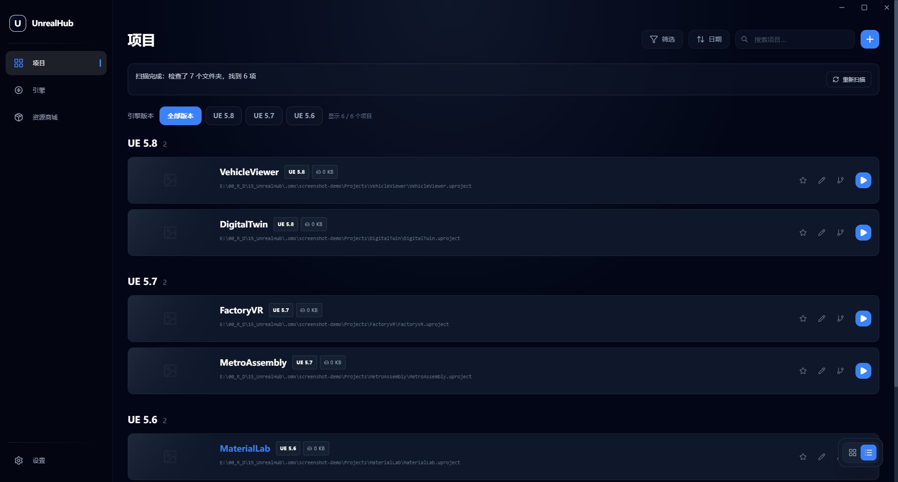
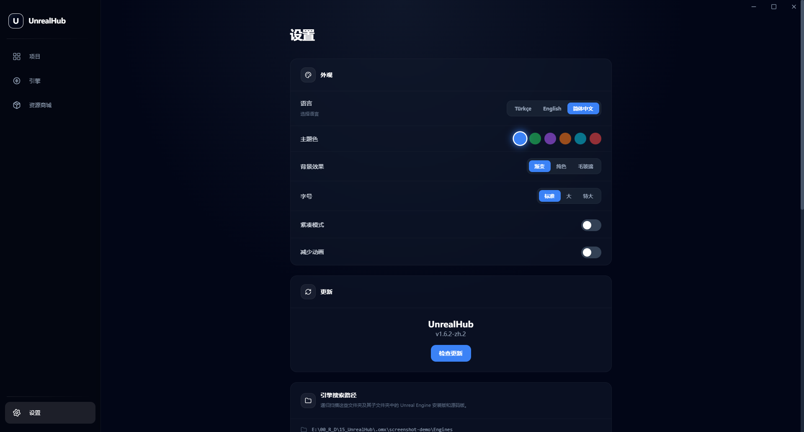
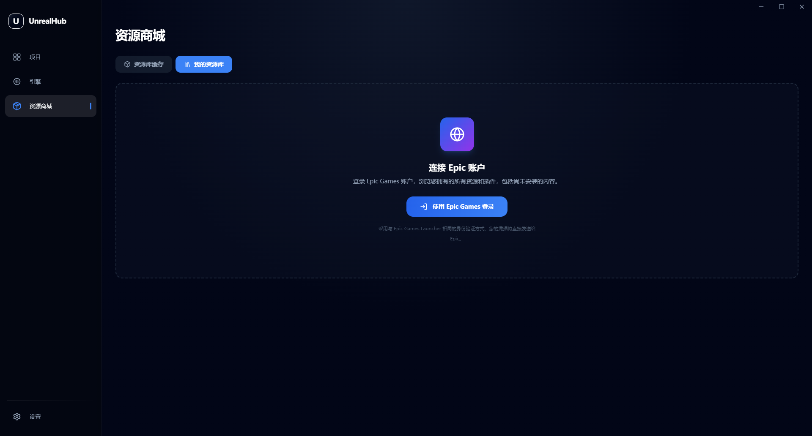

# UnrealHub 中文修改版

[English](README_EN.md) · [Türkçe](README_TR.md) · [中文使用说明](README_ZH.md) · [完整改动日志](CHANGELOG.md)

UnrealHub 是 Unreal Engine 项目与引擎管理工具。本仓库是 [Sami-Uysal/UnrealHub](https://github.com/Sami-Uysal/UnrealHub) 的公开修改版，由 GoldenDragons 维护，保留原作者 Sami Uysal 的署名、上游历史和 [MIT 许可证](LICENSE)。它并非上游官方发行版。

当前版本：**1.6.2-zh.2**，基于上游 1.6.1。此版本包含此前 `1.6.1-zh.2`～`1.6.1-zh.4` 本地迭代的全部改动。

**[下载 Windows x64 安装版和免安装版](https://github.com/GoldenDragons/UnrealHub/releases/latest)**

## 新增：关闭到托盘

点击右上角关闭按钮或使用 Alt+F4 后，程序隐藏到系统托盘并继续后台运行。点击/双击托盘图标，或右键选择“显示窗口”可恢复；要完全退出，请右键托盘图标选择“退出 UnrealHub”。再次打开 exe 会恢复已运行的实例。

新版安装包、免安装包及校验文件见下方 Release；本地编译产物在 `release/1.6.2-zh.2/`。

## 这次更新了什么

- **递归搜索**：搜索根目录及多层子目录，重叠路径去重，跳过目录链接和常见生成缓存。
- **边扫描边显示**：已找到的引擎、项目立即显示；页面提供已检查目录数、已找到数量、当前目录和重新扫描按钮。
- **大目录性能修复**：使用有界并发广度优先遍历，多个请求共享扫描任务；识别到项目后跳过其资源/源码内部，项目体积计算延后并限制为两路并发。
- **引擎分类**：分为源码版和安装版，各组按真实版本号从新到旧排列，不依赖文件夹名称排序。
- **项目版本按钮**：全部 UE 版本并排显示，点击即可筛选；选择“全部版本”后，按版本分组，每个版本标题下展示对应项目及数量。
- **保留现有操作**：分组内继续支持搜索、标签、收藏排序、网格/列表和卡片大小切换。
- **中文与商城修复**：保留 302 条简体中文翻译和语言记忆，修复点击资源商城后整个窗口灰屏。

逐项变更、修复原因与验证范围见 [CHANGELOG.md](CHANGELOG.md)。

## 新版界面

下列六张图片均从 **1.6.2-zh.2 实际 exe 的最大化窗口**截取，分辨率 **1920×1032**。使用独立演示目录和项目，避免公开私人项目或账号信息；并非上游旧截图，也不是小窗口裁图。

### 全部版本：按 UE 版本分组


### 点击按钮：只显示选定版本


### 列表视图同样保留版本分组



### 源码版与安装版引擎


### 中文设置与递归搜索路径



### 可正常进入的资源商城



## 下载与运行

在 [Release](https://github.com/GoldenDragons/UnrealHub/releases/tag/v1.6.2-zh.2) 中下载：

| 文件 | 用途 |
| --- | --- |
| `UnrealHub-Windows-1.6.2-zh.2-Setup.exe` | 安装版，支持中文安装界面及安装目录选择 |
| `UnrealHub-Windows-1.6.2-zh.2-zh-CN-Portable.exe` | 免安装版，双击运行 |
| `SHA256SUMS.txt` | 两个 exe 的 SHA-256 校验值 |

运行无需安装 Node.js。首次使用时，在设置中添加引擎和项目搜索目录；语言可在 **Settings → Language → 简体中文** 中选择。旧版的设置仍可继续使用。

## 编译与验证

```powershell
npm.cmd ci --no-audit --no-fund
npx.cmd tsc --noEmit
npm.cmd run build -- --publish never
node scripts/check-scanning.mjs
node scripts/check-versions.mjs
node scripts/check-marketplace.mjs
```

产物位于 `release/1.6.2-zh.2/`。回归脚本要求 Node.js 22+；商城测试会打开独立测试实例并自动关闭，不登录 Epic。

重新生成新版全屏配图：

```powershell
node scripts/capture-screenshots.mjs
```

该脚本使用独立演示数据，最大化实际程序后截图，不读取现有 Epic 登录信息。

## 已知限制

- 部分生成目录和目录链接会跳过；未注册且无法解析的源码引擎关联归入“未知版本”。完整扫描大目录仍需要时间，结果会逐步显示。
- 类型检查、生产构建、扫描/版本/商城回归和实际界面验证通过；现有 71 个 lint 错误、5 个警告未在本版清理。
- 安装版安装流程、Epic 登录与资源下载未做验收。本版主要修复扫描和界面，**尚未完成此前审计发现的登录令牌存储等安全加固**，不应据此认定 Epic 登录已安全。

更多操作说明见 [README_ZH.md](README_ZH.md)。上游提交基线为 `7467409323055cbaff62383be0704e0d5b03534f`。
