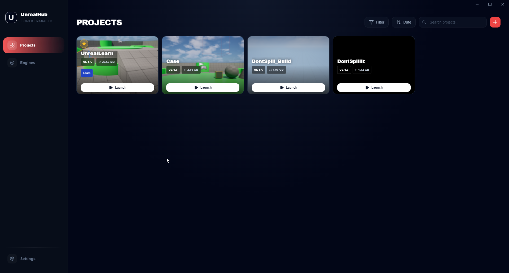

# UnrealHub 中文修改版

[English](README_EN.md) | [上游土耳其语说明](README_TR.md) | [中文运行与编译说明](README_ZH.md)

本仓库是 [Sami-Uysal/UnrealHub](https://github.com/Sami-Uysal/UnrealHub) 的公开 Fork，基于上游 **1.6.1**（提交 `7467409323055cbaff62383be0704e0d5b03534f`）修改，由 GoldenDragons 维护。UnrealHub 是使用 Electron、React 和 TypeScript 开发的 Unreal Engine 项目与引擎管理工具。

本仓库并非上游官方发行版。原作者为 **Sami Uysal**，保留原项目历史与 [MIT 许可证](LICENSE)。

## 本修改版新增与修复

### 简体中文支持

- 新增 **285 条简体中文翻译**，覆盖项目管理、引擎、设置、资源商城、Git 历史、任务看板、配置编辑和确认对话框。
- 在 **Settings → Language → 简体中文** 中切换，重启后保留语言选择。
- 中文浏览器语言自动匹配简体中文，保留英文和土耳其语；部分 Electron 环境默认报告英文，手动切换一次即可。
- 补齐原先写死的加载提示、确认按钮和商城排序、筛选、刷新、取消文案。
- 加入中文字体回退，修正小窗口下“项目”标题逐字换行的问题。

### 修复点击资源商城后整个窗口灰屏

上游 `src/main.tsx` 调用了未通过 preload 暴露的 `window.ipcRenderer.on(...)`，启动时产生 `Cannot read properties of undefined (reading 'on')`。资源商城的懒加载模块依赖共享入口，随后因该异常加载失败，导致整个 React 界面退出渲染。

此修改版移除了这段仅打印启动消息的无效监听。应用继续通过现有 `window.unreal` 桥接接口工作，点击资源商城可以正常进入页面。

### Windows 发布

- 提供 **Windows x64 安装版和免安装版**，安装界面支持中文。
- 使用独立修改版版本号 **1.6.1-zh.1**，更新源指向本 Fork 的 Releases。
- 编译配置明确使用 `electron-builder.json5`；GitHub 构建工作流改为手动触发，避免手动发布标签时自动重复打包。

## 下载与运行

前往 **[本仓库 Releases](https://github.com/GoldenDragons/UnrealHub/releases/latest)** 下载：

| 文件 | 用途 |
| --- | --- |
| `UnrealHub-Windows-1.6.1-zh.1-Setup.exe` | 安装版，可选择安装目录 |
| `UnrealHub-Windows-1.6.1-zh.1-zh-CN-Portable.exe` | 免安装版，双击运行 |
| `SHA256SUMS.txt` | 文件 SHA-256 校验值 |

运行 exe 无需安装 Node.js。在“设置”中添加引擎和项目搜索目录，或在项目页面导入 `.uproject`。



## 从源码编译

```powershell
npm.cmd ci --no-audit --no-fund
npx.cmd tsc --noEmit
npm.cmd run build -- --publish never
```

输出目录：`release/1.6.1-zh.1/`。`win-unpacked` 中的程序需要保留整个文件夹，两个单独分发的 exe 请从 Releases 下载。

使用 Node.js 22+ 验证实际免安装程序的商城入口：

```powershell
node scripts/check-marketplace.mjs
```

测试会启动独立应用实例，检查启动异常并完成 3 轮“资源商城 → 设置”切换，随后关闭测试实例。无需登录 Epic 账户。

## 验证范围

- TypeScript 检查和 Windows 生产构建通过。
- 三种语言翻译键与插值占位符一致，语言检测、切换和保存选择已验证。
- 实际免安装 exe 的商城入口及连续导航回归检查通过，无未捕获异常，React 根节点保持挂载。
- 上游现存 71 个 lint 错误、5 个警告，本次没有新增。
- 未验证安装版安装流程、Epic 登录、资源下载以及真实项目的删除/缓存清理等操作。

更多运行细节见 [中文说明](README_ZH.md)。原项目功能与文档见 [上游仓库](https://github.com/Sami-Uysal/UnrealHub)、[英文说明](README_EN.md) 和 [土耳其语说明](README_TR.md)。
