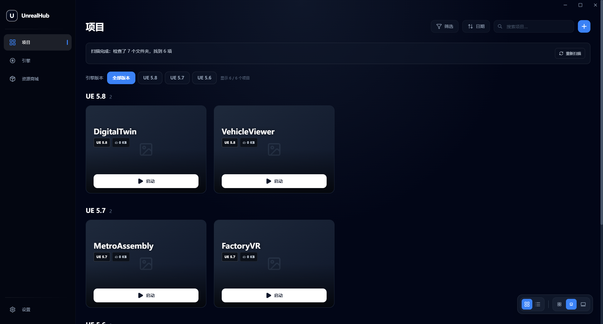
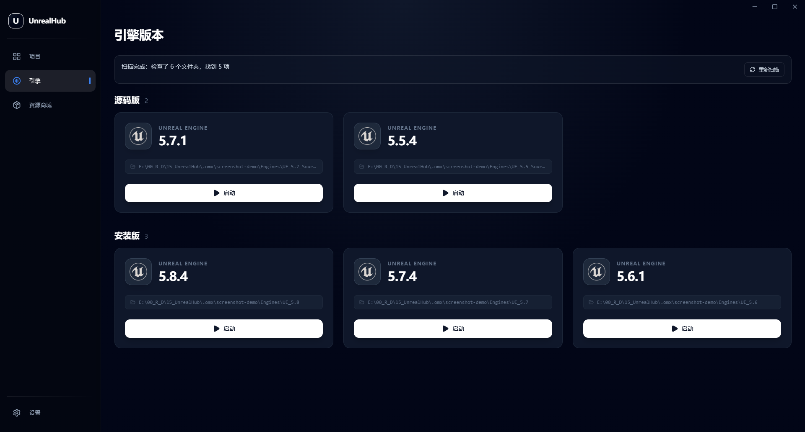
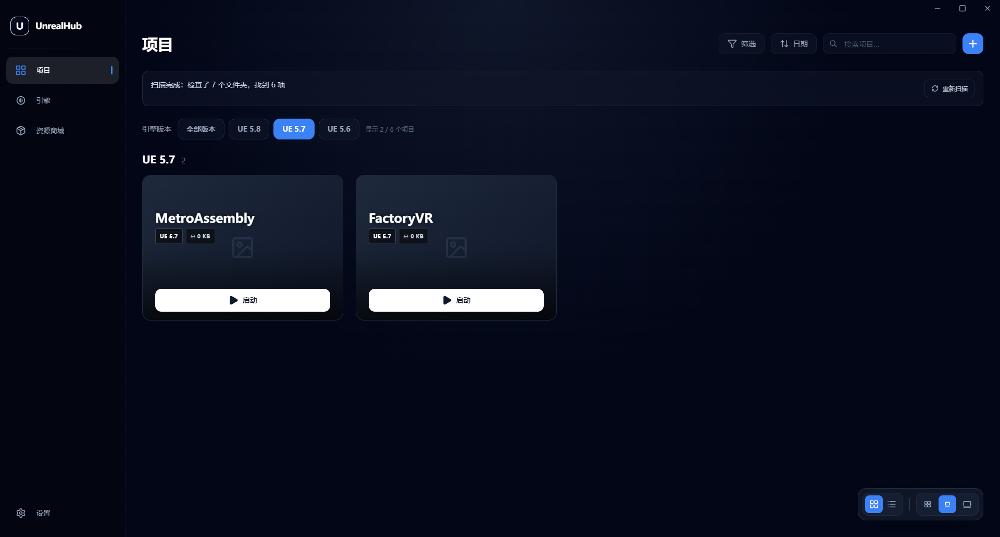

# UnrealHub — Chinese Modified Edition

## Epic Games Launcher vs UnrealHub

**A local workspace for multi-version UE development: recursive discovery, project version groups, and source/installed engine organization.**

| Workflow | Epic Games Launcher | This UnrealHub fork |
| --- | --- | --- |
| Primary role | Official engine installation and content ecosystem | **Manage engines and projects already on your machine** |
| Copied or nested projects | Epic documents opening copied projects locally before they appear in the list | **Recursively discover `.uproject` files under configured roots** |
| Discovery feedback | Epic documents the Library project-list workflow | **Progressive results, folder counts, current path and rescan** |
| Engine builds | Launcher installs precompiled builds; source builds are obtained separately | **Source and installed groups, sorted numerically** |
| Project versions | Project entries show their compatible UE version | **Version buttons and separate version sections in All Versions** |
| Project tools | Open, locate, shortcut, clone and delete actions | **Tags, favorites, notes, task boards, Git history and config editing** |
| Accounts and background use | An Epic login is required to download engines | **Local discovery needs no Epic login; close to tray** |
| Engine installation and updates | Official installation/update support | **Continue using Epic's tools for engine installation and updates** |

**[Download Windows x64 builds](https://github.com/GoldenDragons/UnrealHub/releases/latest)** · [Current interface](#current-interface)

Sources: [Epic's project-opening guide](https://dev.epicgames.com/documentation/en-us/unreal-engine/opening-an-existing-unreal-engine-project) and [installation guide](https://dev.epicgames.com/documentation/unreal-engine/install-unreal-engine). This compares documented workflows with implemented features, not unverified feature absences or unbenchmarked speed/memory claims. Marketplace and security limitations are described below.


[简体中文](README.md) · [Türkçe](README_TR.md) · [Changelog](CHANGELOG.md)

This is a public modified fork of [Sami-Uysal/UnrealHub](https://github.com/Sami-Uysal/UnrealHub), based on upstream 1.6.1 and maintained by GoldenDragons. It preserves Sami Uysal's attribution, upstream history and the [MIT license](LICENSE). It is not an official upstream release.

Current version: **1.6.2-zh.2**. [Download Windows x64 installer or portable executable](https://github.com/GoldenDragons/UnrealHub/releases/latest).

## Changes in this fork

- Closing the window hides it to the system tray. Click the tray icon to restore it, or use Quit UnrealHub to exit. Opening the executable again restores the existing instance.

- 302 Simplified Chinese translation strings, persistent language selection, and English/Turkish support.
- Fix for the whole-window blank screen when opening Marketplace.
- Recursive engine/project discovery, including search roots and nested folders, with overlapping-path deduplication.
- Progressive results and visible scan progress, error messages and a rescan button. Large-directory traversal uses bounded breadth-first batches and shares in-flight scan tasks.
- Source and installed engine groups, sorted by actual numeric version. Source GUID associations are resolved when possible.
- Side-by-side project version buttons. All versions are displayed in separate version sections with project counts; search, tags, favorites and grid/list views work within these groups.

See the [detailed changelog](CHANGELOG.md) for local iteration history, validation and limitations.

## Current interface

All images below are from the actual **1.6.2-zh.2 executable**, maximized to 1920×1032, using isolated demo projects. Upstream's old screenshots have been removed.







## Build and verify

```powershell
npm.cmd ci --no-audit --no-fund
npm.cmd run build -- --publish never
node scripts/check-scanning.mjs
node scripts/check-versions.mjs
node scripts/check-marketplace.mjs
node scripts/capture-screenshots.mjs
```

Build output: `release/1.6.2-zh.2/`. Test/screenshot scripts require Node.js 22+. Executables do not require Node.js. Select Simplified Chinese in Settings → Language.

Existing lint findings have not been cleaned up. Installer installation, Epic login and asset downloads have not been acceptance-tested; previously identified token-storage security weaknesses are not hardened by this release. See the [Chinese guide](README_ZH.md) for scanning rules and operating details.
