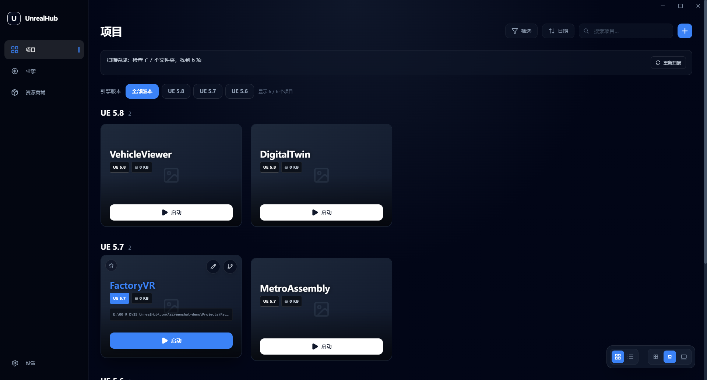
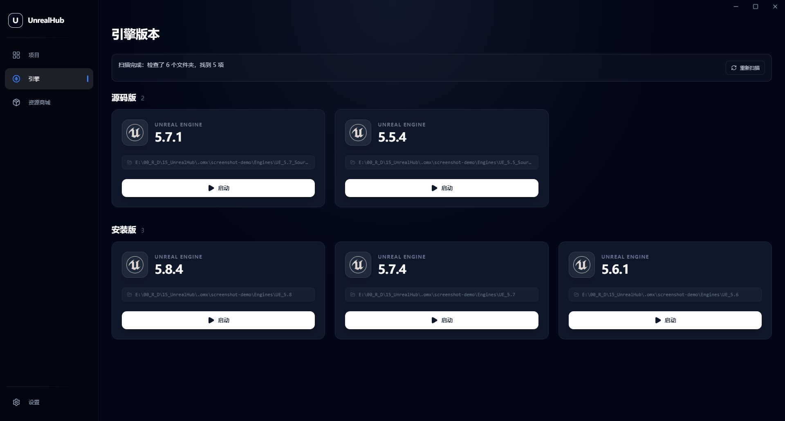

# UnrealHub — Çince Destekli Değiştirilmiş Sürüm

[简体中文](README.md) · [English](README_EN.md) · [Değişiklik günlüğü](CHANGELOG.md)

Bu depo, [Sami-Uysal/UnrealHub](https://github.com/Sami-Uysal/UnrealHub) 1.6.1 tabanlı, GoldenDragons tarafından sürdürülen açık bir fork'tur. Sami Uysal'ın adı, kaynak geçmişi ve [MIT lisansı](LICENSE) korunur. Resmî üst kaynak sürümü değildir.

Güncel sürüm: **1.6.2-zh.2**. [Windows x64 kurulum ve taşınabilir paketlerini indir](https://github.com/GoldenDragons/UnrealHub/releases/latest).

## Başlıca değişiklikler

- Pencere kapatıldığında sistem tepsisinde çalışmaya devam eder. Tepsi simgesi pencereyi geri getirir; çıkış menüsü uygulamayı tamamen kapatır. Tekrar açmak mevcut pencereyi gösterir.

- Basitleştirilmiş Çince desteği, dil seçimi ve seçimin saklanması; Türkçe ve İngilizce korunur.
- Marketplace açıldığında tüm pencerenin boş kalmasına neden olan hata düzeltildi.
- Motor ve proje klasörleri alt klasörleriyle birlikte taranır; bulunan sonuçlar tarama bitmeden gösterilir.
- Tarama ilerlemesi, hata bildirimi ve yeniden tarama düğmesi eklendi. Büyük dizinlerde sınırlı eşzamanlılık ve ortak tarama görevleri kullanılır.
- Kaynak kod motorları ve kurulu motorlar ayrı gruplarda, gerçek sayısal sürüme göre sıralanır.
- Proje sürümleri yan yana düğmelerle seçilir. Tüm sürümler görünümünde her UE sürümünün kendi başlığı, sayısı ve proje grubu vardır.

Ayrıntılı sürüm geçmişi ve doğrulama kapsamı için [CHANGELOG.md](CHANGELOG.md).

## Yeni arayüz

Görseller gerçek **1.6.2-zh.2 exe** dosyasından, büyütülmüş 1920×1032 pencere ve bağımsız örnek projeler kullanılarak alınmıştır. Eski üst kaynak görselleri kullanılmaz.

Derleme komutu: `npm.cmd ci` ve `npm.cmd run build -- --publish never`. Çıktı: `release/1.6.2-zh.2/`. Çalıştırmak için Node.js gerekmez.

Kurulum, Epic girişi ve indirmeler kabul testinden geçirilmemiştir. Önceden belirlenen token saklama güvenlik sorunları bu sürümde giderilmemiştir. İşletim ve tarama ayrıntıları [Çince kılavuzda](README_ZH.md) açıklanır.
