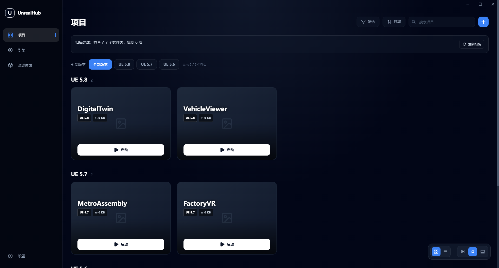

# UnrealHub 中文使用说明

当前版本：**1.6.2-zh.1**。这是 [Sami-Uysal/UnrealHub](https://github.com/Sami-Uysal/UnrealHub) 的修改版；界面截图、功能介绍和下载见 [主页](README.md)，逐版本变更见 [改动日志](CHANGELOG.md)。

## 运行与升级

从 [最新发布](https://github.com/GoldenDragons/UnrealHub/releases/latest) 下载安装版或免安装版。运行 exe 无需 Node.js；使用新版前先关闭旧版即可，已保存的搜索路径和界面设置可继续使用。

本地编译输出：`release/1.6.2-zh.1/`。`win-unpacked/UnrealHub.exe` 必须和整个文件夹一起保留，不能单独复制该 exe。

## 递归搜索

在“设置 → 引擎搜索路径 / 项目搜索路径”添加目录。程序检查该目录本身和多层子目录；不用逐个添加每个项目文件夹。

- 已找到的结果立即显示，不必等整棵目录树扫描结束。
- 状态条显示已检查目录数、已找到数量和当前扫描位置。
- 扫描完成后可点击“重新扫描”，读取新增或移动的项目与引擎。
- 重叠路径会去重；无法访问的目录不会阻断其它分支，界面会提示异常。
- 符号链接、目录联接、常见生成缓存，以及已识别项目的 Content/Source/Plugins 等内部目录会跳过，减少重复和无效遍历。普通子文件夹继续递归。

## 引擎分类

源码版和安装版分别显示，组内按数字版本从新到旧排序。版本来自 `Engine/Build/Build.version`，安装版依据 `Engine/Build/InstalledBuild.txt` 标记识别。

源码引擎未编译时仍可能被发现，但只有存在对应编辑器可执行文件时才能启动。源码项目 GUID 关联会尝试查询本机 Windows 引擎注册信息；无法解析时显示“未知版本”。

## 项目版本按钮与分组

所有已发现项目的 UE 主次版本以并排按钮显示；点击某个版本只显示该版本的项目。

选择“全部版本”时，每个 UE 版本有独立标题、项目数量和项目区域，按新到旧排列；未知版本在最后。同一主次版本的补丁版会归入同组，例如 5.7、5.7.1 和 5.7.4 都属于 UE 5.7。

搜索和标签筛选继续作用于这些分组。收藏优先及名称/日期排序在各组内生效；网格/列表和卡片大小同样适用。



## 编译、测试与截图

```powershell
npm.cmd ci --no-audit --no-fund
npx.cmd tsc --noEmit
npm.cmd run build -- --publish never
node scripts/check-scanning.mjs
node scripts/check-versions.mjs
node scripts/check-marketplace.mjs
node scripts/capture-screenshots.mjs
```

脚本使用 Node.js 22+。截图脚本会创建独立演示数据，最大化实际 exe 后生成 `github-assets/*-fullscreen.png`，不使用真实账号或私人项目。

Windows 若在 electron-builder 24 解压 winCodeSign 工具时遇到 macOS 符号链接权限错误，可仅解压 Windows 工具到 electron-builder 的 `winCodeSign/winCodeSign-2.6.0` 缓存再构建。本次构建使用此方式，无需更改系统权限。

## 验证与限制

扫描合成目录测试、数字版本排序测试、实际 exe 的版本按钮/分组/搜索/列表测试、商城连续导航及截图检查通过。大目录真实路径测试也确认了后台扫描过程中结果可见；阶段数量不代表全部项目或固定性能承诺。

原有 lint 问题未清理；安装流程、Epic 登录和资源下载未验收。此前安全审计发现的令牌存储等问题尚未加固，参见 [主页的已知限制](README.md#已知限制)。更新源为本 Fork 的 Releases。
